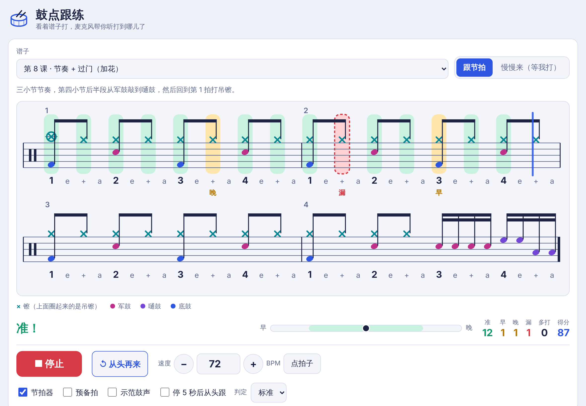

# 鼓点跟练

给刚入门的小鼓手用的练习网页：屏幕上显示鼓谱，麦克风听他打鼓，实时标出打到哪里、打得准不准。可以跟着教材伴奏的音频文件练，也可以只跟节拍器练。

在线使用：<https://flyeversheep.github.io/drum-coach/>（iPad 用 Safari 打开；页面最底部显示当前版本号）

纯网页，没有任何依赖，没有服务器。麦克风的声音、谱子、伴奏文件和设置都只留在本机浏览器里，不会上传。



## 怎么用

1. **选谱子**。内置 9 个入门练习（从数拍子到带过门的节奏）；自己的曲目在「编辑谱子」里录入或导入，见下文。
2. **选练习方式**：
   - **跟节拍**：蓝线按速度往前走。打得准的音变绿，早了或晚了变黄，那个音附近完全没打才标成漏。结束后给出得分和「整体偏早/偏晚多少毫秒」。
   - **慢慢来（等我打）**：没有速度要求，亮着的是下一个要打的音，打一下往前走一格，同时显示他现在的大致速度和稳不稳。适合刚开始认谱的时候。
3. **按「开始」**（或空格键）。第一次会请求麦克风权限。
4. **调灵敏度**。「麦克风」面板里，红色竖线是门槛：不打鼓时音量条要留在竖线左边。每听到一下，旁边的绿灯会闪。
5. **校准一次声音延迟**。按「自动校准」，它会播 10 下滴答声。外放时什么都不用做；戴耳机时跟着滴答声拍手。换耳机或音箱后重做。

谱子怎么看：`×` 是镲（带圈的是吊镲），圆点从上到下是高音嗵鼓、军鼓、落地嗵鼓、底鼓，颜色见页面上的图例；下面的 `1 e + a` 是数拍子的方法。

### 重新来一遍

- 点「开始」旁边的 **↺ 从头再来**，谱子立刻回到开头；跟伴奏练时音乐也一起倒回开头。
- 勾着「停 5 秒后从头跟」（默认开）时，停下不打超过 5 秒，谱子自己回到第一个音等着，他再打第一下就重新开始。这一条在「慢慢来」和节拍器下有效；跟伴奏练时音乐不会自动倒回去，用上面的按钮。

### 判定的宽严

「判定」有宽松、标准、严格三档。算「准」的范围分别是 ±100、±65、±40 毫秒；超出但离这个音最近的击打算早或晚，最远到 350、250、150 毫秒。

## 跟伴奏一起练

「伴奏音乐」里选 **本地音频文件**（默认），点「添加伴奏文件」，可以一次选多个 mp3 / m4a / wav。

- **自动归类**：文件名里带曲名的会配到对应曲目并记住，以后选曲目就自动载入。每首曲子可以存三个版本，按文件名区分：
  - 带 `Demo` → 示范（带鼓）
  - 带 `with click` → 伴奏 + 滴答声
  - 带 `without click` → 伴奏（无滴答声）
- **自动对拍**：载入时程序按曲目的速度找到录音里的节拍，并按「两小节预备拍」算出第 1 小节从第几秒开始。没有滴答声的伴奏没法这样听出来，会借用同一首曲子示范版的结果，所以它要和示范版一起添加。
- **预备拍**：预备拍期间屏幕显示「预备… 1 2 3 4」，不判定。
- **核对和微调**：勾上「节拍器」，听滴答声和音乐是否重合；不重合就用「第 1 拍在」旁边的 − / + 调（每次 20 毫秒），或者播放时从某小节第 1 拍开始按「点拍子」8 下。调好的结果按文件记住。
- **放慢**：「播放速度」可以降到 50%，不变调。

音频文件需要自己准备。教材的配套录音受版权保护，本仓库不提供，也请不要把它们提交到公开仓库。

给孩子打分时，用不带鼓的伴奏，或者让他戴耳机听：外放带鼓的示范版时，录音里的鼓声也会被麦克风当成他打的。

### 只用节拍器

「伴奏音乐」里选「只用节拍器」，用「速度」设 BPM，可以开预备拍和示范鼓声（程序合成的鼓声，按谱子演奏）。

## 自己的谱子

- **录入**：打开「编辑谱子」，点格子加减音符，自动保存。改内置练习会自动另存一份。每份最多 64 小节。
- **导出和导入**：「编辑谱子」底部的「导出」会生成一个以 `#import=` 结尾的链接，谱子的全部内容都在链接里。在另一台设备上打开它，或粘贴到「导入」框，谱子就存进那台设备。链接本身就是备份。导入会覆盖同一首曲目现有的内容。
- **只存在本机**：谱子保存在浏览器里。注意 iPad 上 Safari、「添加到主屏幕」的图标、其他 App 里弹出的内置浏览器，三者的数据互不相通，在哪里用就在哪里导入。

谱子列表里的 Book 1 是九个只有曲名的空位（ABRSM Drum Kit Exam Pieces from 2024, Initial Grade），音符需要照着自己的书录入。有版权的曲谱请不要放进公开仓库或公开分享。

## 需要知道的限制

- **只听节奏，不分鼓件**。麦克风能判断什么时候打了一下，分不出打的是军鼓、底鼓还是镲。「准」的意思是节奏对。
- **外放的声音会进麦克风**。音乐或节拍器外放时可能被当成击打，戴耳机最稳；有线耳机最省心，蓝牙耳机延迟大，一定要校准。
- **很轻的音可能听不到**。检测看的是声音有没有突然变响，分低、中、高三个频段，余音没散时也能认出新的一下；比门槛轻的声音只在谱子上正好有音符的位置才算数。但被很响的余音完全盖住的轻踩镲仍然可能漏。
- **iPad 上不能和别的 App 同时放歌**。网页一用麦克风，系统就会暂停「音乐」等其他 App，所以伴奏要导入到页面里播。
- **只支持 4/4 拍**，最细到十六分音符，没有三连音、开镲、装饰音和力度记号；跟伴奏练时假设整首速度不变。

## 在自己电脑上运行

浏览器只允许 `https://` 或 `http://localhost` 的页面使用麦克风，所以不能直接双击 `index.html`。

- **Mac**：双击 `start.command`（第一次可能要右键 → 打开）。
- **Windows**：先装 [Python](https://www.python.org/downloads/)，再双击 `start.bat`。
- **终端**：

```bash
python3 -m http.server 8080
```

然后打开 <http://localhost:8080>。

想放到自己的网址上：这是一个纯静态网站，把整个文件夹放到任何支持 https 的静态空间即可。本仓库用的是 GitHub Pages，从 `main` 分支根目录发布。

## 改代码

```
index.html        页面
style.css         样式
js/scores.js      内置练习、曲目空位、谱子的导入导出编码
js/notation.js    鼓谱绘制、蓝线和标记
js/audio.js       节拍器、示范鼓声、麦克风击打检测
js/music.js       本地音频播放、伴奏文件存储、自动对拍、Apple Music
js/app.js         练习逻辑和界面
tools/make-token.mjs  生成 Apple Music 开发者令牌
```

- **版本号**：每次改动文件，把 `index.html` 里所有 `?v=数字` 和页脚的「版本 数字」一起加一，这样设备不会把缓存的旧脚本和新页面混用。
- **隐藏着的功能**，代码都在，只是没有入口：
  - **Book 2 的曲目空位**：从 `js/scores.js` 的 `DC.HIDDEN_BOOKS` 里去掉 `'Book 2'` 即可显示。
  - **别的 App 放歌**（页面不出声，按第一下击打和设定速度走谱）和 **Apple Music**（通过 MusicKit 在页面里播放，需要 Apple 开发者令牌，未经实际播放验证）：在 `index.html` 的 `#srcSeg` 里加回 `data-src="ext"` / `data-src="apple"` 的按钮，并放宽 `js/app.js` 开头把来源限制为 `file` / `metro` 的那一行。
- **曲目顺序**：导入链接按位置引用 `DC.PIECES` 里的曲目，新曲目只能加在末尾。
